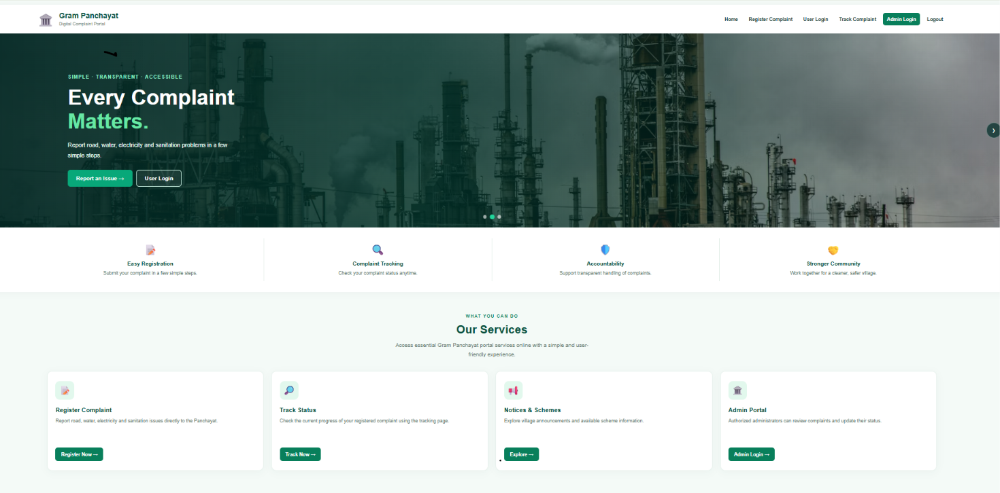
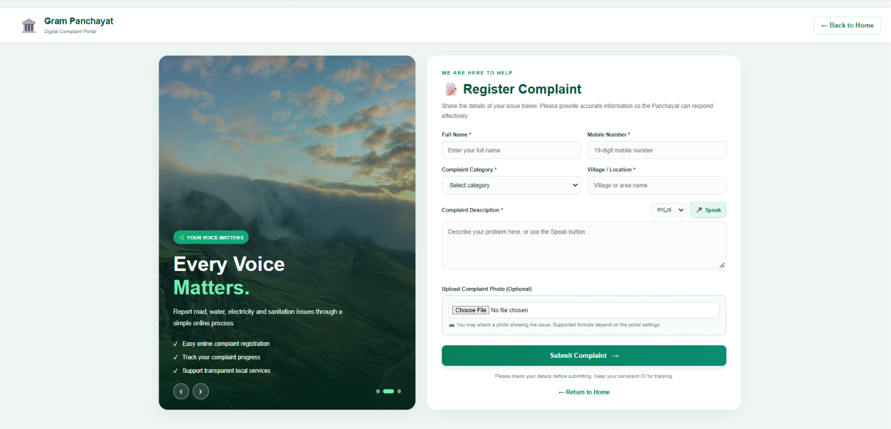
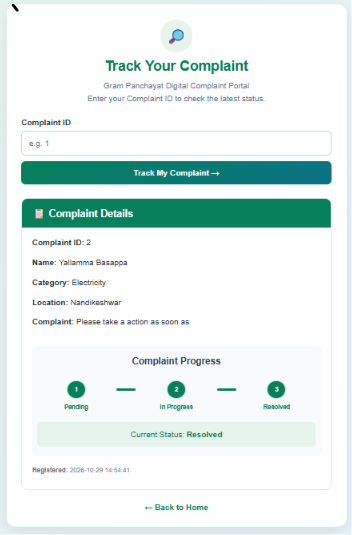
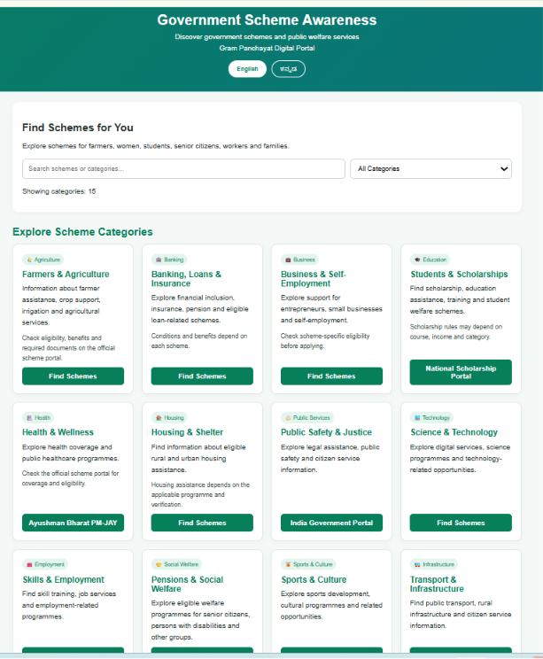
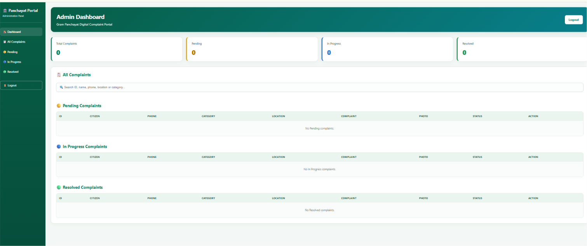

# 🏛️ Panchayat Digital Portal

### Digital Complaint Management System for Gram Panchayat

A web-based platform designed to help citizens submit complaints online and track their resolution status conveniently.

## 🌐 Live Demo

**[Visit Panchayat Digital Portal](https://panchayat-digital-portal-1.onrender.com)**

## 🎯 Problem Statement

Traditional Gram Panchayat complaint management often relies on manual processes, making it difficult for citizens to submit complaints, monitor progress, and know when issues are resolved.

## 💡 Solution

Panchayat Digital Portal provides a centralized online platform where citizens can register complaints, upload supporting photos, and track complaint status. Administrators can review complaints and update their progress.

## ✨ Features

- 👤 User registration and login
- 📝 Online complaint registration
- 📷 Complaint photo upload
- 🔎 Complaint status tracking
- 📊 Admin dashboard
- 🔄 Complaint status updates: Pending, In Progress, Resolved
- 🏘️ Online access to Panchayat services

## 🛠️ Technologies Used

- **Frontend:** HTML, CSS, JavaScript
- **Backend:** Python, Flask
- **Database:** MySQL
- **Deployment:** Render
- **Version Control:** Git and GitHub

## 📸 Project Screenshots

### 🏠 Home Page

### 📝 Complaint Registration

### 🔎 Track Complaint

### 📢 Schemes

### 🛡️ Admin Dashboard

## ⚙️ Local Setup

1. Clone this repository.
2. Create and activate a Python virtual environment.
3. Install dependencies using `pip install -r requirements.txt`.
4. Configure database connection settings using environment variables.
5. Run the application using the appropriate Flask command.

## 🔐 Security

Database credentials and secret keys should be stored in environment variables and must not be committed to the repository.

## 👩‍💻 Project

**Panchayat Digital Portal — Making citizen complaint management more accessible and transparent.**
